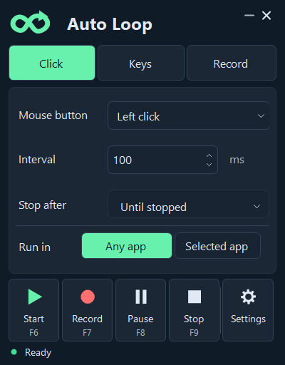
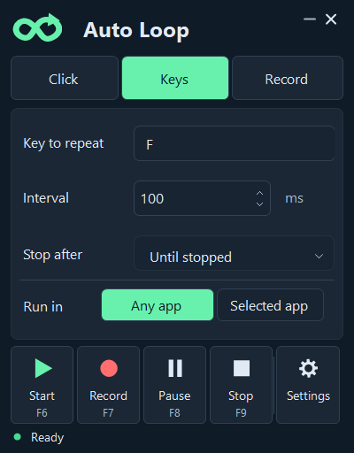
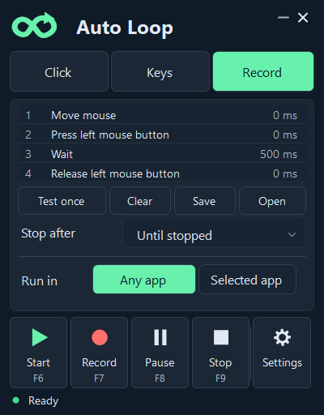
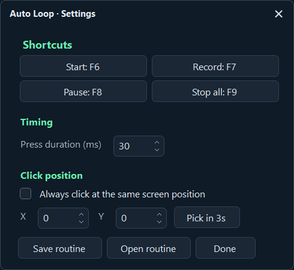

# Auto Loop

A small portable Windows app for repeated mouse clicks, repeated keys, and recording/replaying actions—without writing scripts.

**Early release · Windows x64 · No installer**

[Download portable ZIP](https://github.com/RikkYS/Auto-Loop/releases/download/v0.6.0/Auto-Loop-0.6.0-Portable.zip) · [Download EXE](https://github.com/RikkYS/Auto-Loop/releases/download/v0.6.0/Auto-Loop-0.6.0.exe)

## What it does

- **Click:** repeat left, right, or middle clicks.
- **Keys:** click the key field and press the key you want to repeat.
- **Record:** record mouse movement, clicks, scrolling, and keyboard actions, then replay them.
- Run in **Any app**, or restrict input to a **Selected app**.
- Stop after a repeat count, a duration, or when you press Stop.
- Save recordings and customize the shortcuts.

## Run it

Requires **64-bit Windows and .NET Framework 4.x**.

1. Download the [portable ZIP](https://github.com/RikkYS/Auto-Loop/releases/download/v0.6.0/Auto-Loop-0.6.0-Portable.zip) from [Releases](https://github.com/RikkYS/Auto-Loop/releases).
2. Extract it into a folder you can write to.
3. Open **Auto Loop.exe**. No installer or source files are needed.

Auto Loop creates its settings and saved routines beside the EXE. If you move it later, keep any recordings and settings you want to preserve.

## Click or repeat a key

| Click | Keys |
|---|---|
|  |  |

1. Choose **Click** or **Keys** and select the mouse button or key.
2. Set the **Interval**. `100 ms` is approximately ten presses per second.
3. Choose **Stop after**: repeats, seconds, or Until stopped.
4. Choose **Any app**, or **Selected app** and a window.
5. Press **Start**. Auto Loop minimizes automatically; switch to your app during the three-second countdown.
6. Press **F9** to stop.

## Record and replay

1. Choose **Record**, then press **F7**.
2. Switch to the app you want to record during the three-second countdown.
3. Perform your actions, then press **F7** again or **F9** to finish.
4. Choose **Test once** to play one pass before looping. This does not change your repeat or time settings.
5. Choose **Start** to play using your Stop after settings.
6. Use **Save** to keep the recording, or **Open** to load one later.

The four rows in the screenshot are an example, not a four-step limit. Mouse press and release are separate events so holds and drags can be replayed. The time on the right is the delay **before** that event.

**Clear** empties the in-memory recording. Right-click a step to change its delay or remove it. A broken press/release pair is rejected before playback.

Keep window positions, screen arrangement, and display scaling consistent. Auto Loop replays screen positions; it does not recognize buttons or automatically wait for files to load.

## Shortcuts and settings

| Default | Action |
|---|---|
| F6 | Start |
| F7 | Record / finish recording |
| F8 | Pause / resume |
| F9 | Stop, including during the countdown |

Use **Settings** to change shortcuts, press duration, or fixed click position. If a shortcut is already reserved by another app, check the labels for the active binding; Auto Loop may use Ctrl+Alt variants.

## Why playback pauses

- **Selected app is not active:** return to that window. If automatic resume is off, press Pause to resume.
- **Auto Loop is active:** minimize its window and return to the app being automated.
- **Paused by you:** press Pause again to continue.

Hover over the status for more detail. Input is released when playback stops or loses its selected target. Interrupted repetitions restart from the beginning when resumed. Closing the selected window stops the routine.

With **Any app**, no window selection is required, and input follows whichever app is active. Auto Loop avoids sending playback into its own windows.

## Current testing and limits

This is an early release. **46 automated checks pass.** The supplied recording also completed ten engine-simulated loops with matching mouse presses and releases and no held inputs left behind.

A live sample-file test was attempted, but Windows blocked simulated input in the test session. The user's exact desktop open/close routine is therefore **not verified on screen** in this release. See [TESTING.txt](TESTING.txt) for the test scope.

Some applications reject simulated input, and Windows can block input to applications with higher permissions. Game compatibility is unverified; check the game's automation rules before use. Background playback and image recognition are not included. The EXE is unsigned.

The app has no accounts, telemetry, or network features.

## Feedback

When reporting a problem, include the selected mode, Any app/Selected app setting, active shortcut, what you expected, and what happened. If sharing a recording, check it first for personal text and screen positions you do not want to publish.

## Build from source

Run the included build.ps1 on Windows with the 64-bit .NET Framework compiler installed. It creates Auto Loop.exe in the project root. Source includes the built-in automated checks; run the EXE with --self-test followed by an existing output folder to run them.

