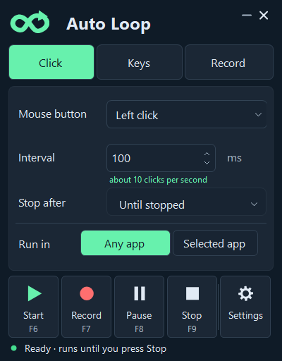
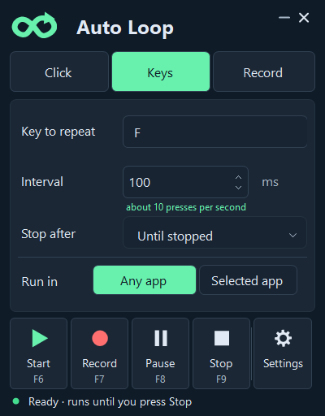
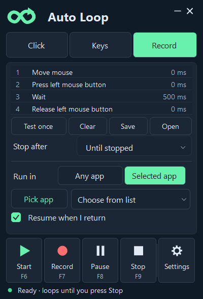
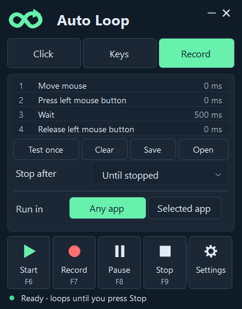
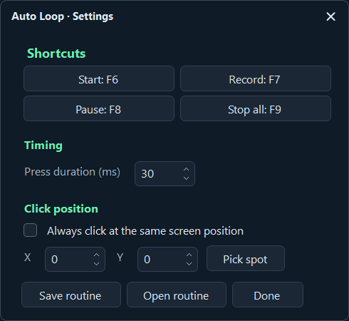

# Auto Loop user guide

This guide walks through each part of Auto Loop. For download and install steps, see the [README](README.md).

## Click or repeat a key

| Click | Keys |
|---|---|
|  |  |

1. Choose **Click** and pick a mouse button (or **Double click**), or choose **Keys**, click the key field and press the key to repeat. Combinations like Ctrl+C work too: Auto Loop holds Ctrl, presses C, then lets go. For double clicks, the interval must leave room for both presses (at least 100 ms with the default press duration).
2. Set the **Interval**. The line under it says what it means, for example "about 10 clicks per second". The shortest interval is 10 ms.
3. Choose **Stop after**: a number of repeats, a number of seconds, or **Until stopped**. The status line at the bottom says what will happen, for example "Ready · about 600 clicks, then stops". Time spent paused doesn't count toward the seconds.
4. Choose **Any app**, or **Selected app** and the app to use (see below).
5. Press **Start**. Auto Loop minimizes and a big 3-2-1 countdown appears in the middle of the screen; switch to your app before it reaches zero.
6. Press **F9**, or **Stop** on the status bar, to stop.

By default a click happens wherever the pointer is. To always click the same spot, open **Settings**, press **Pick spot**, and click the spot on screen. A small green dot briefly marks it. You can also type the X and Y coordinates. Turn off **Always click at the same screen position** to click at the pointer again.

### Choosing the app

With **Selected app**, press **Pick app** and click anywhere in the window you want. That click only chooses the window; it isn't passed on to the app. Press **Esc** or right-click to cancel. You can also open the list next to **Pick app** and choose from the open windows; the list refreshes each time you open it.

### While it runs

- A **status bar** at the top of the screen shows progress (for example "Running · 37 / 600") with **Pause** and **Stop**. It turns red with **Finish** while recording. Drag it if it's in your way; during playback it moves to the bottom edge by itself if a click would land on it.
- An **Auto Loop icon** sits next to the clock. Right-click it for Pause, Stop or Show Auto Loop.
- When a run finishes on its own (or the selected app closes), a Windows notice says so, for example "600 clicks in 1:00".

**Press duration** in Settings is how long each click or key is held down (30 ms by default). It must not be longer than the interval.

## Record and replay

1. Choose **Record**, then press **F7**.
2. Switch to the app you want to record during the three-second countdown.
3. Do your actions, then press **F7** again (or **F9**, or **Finish** on the status bar) to finish.
4. Press **Test once** to play one pass. It ignores your Stop after setting without changing it.
5. Press **Start** to play using your Stop after setting.
6. Press **Save** to keep the recording, or **Open** to load one. If it was made for a selected app and that app is open, Auto Loop selects it again for you.

What gets recorded:

- Mouse moves, button presses and releases (so holds and drags replay correctly), and scrolling.
- Keys, as separate press and release steps, so key combinations replay correctly.
- The number on the right of each step is the delay **before** that step.

What doesn't get recorded:

- Anything you do in Auto Loop's own windows, including its Record or Stop button and the status bar.
- Your Start, Record, Pause and Stop shortcuts.
- In **Selected app** mode, presses and scrolls outside the selected app.
- The keys or click that switched you away from the app (for example Alt+Tab, the Windows key, or a taskbar click). Replaying them would only make playback pause itself.

Right-click a step to change its delay or remove it. If removing a step leaves a press without its release, Auto Loop explains the problem before playback. **Clear** empties the recording after asking you to confirm, and starting a new recording asks before replacing the current one.

Recordings replay **screen positions**. Auto Loop doesn't recognize buttons or wait for windows to load, so keep the window in the same place and add longer delays where the app needs time.

## Shortcuts and settings

| Default | Action |
|---|---|
| F6 | Start |
| F7 | Record / finish recording |
| F8 | Pause / resume |
| F9 | Stop, including during the countdown |

Click a shortcut in **Settings** and press the new key or key combination (Esc cancels). If another app already uses the default function keys, Auto Loop switches to Ctrl+Alt+F6–F9 and shows the active keys on its buttons. Playback can't start until a global Stop shortcut works.

## Why playback pauses

The status bar at the top of the screen shows the reason; hover over the status line in the main window for more detail.

- **Paused: selected app is not active**: return to that window. With **Resume when I return** off, press Pause to continue.
- **Paused: Auto Loop is active**: minimize Auto Loop and go back to the app you are automating.
- **Paused: pointer is outside the selected app**: the next click would have landed in a different window. Move the window or pointer back and press Pause to continue.
- **Paused: the active app runs as administrator**: Windows blocks input to it from a normal app. Switch to another app, or run Auto Loop as administrator.
- **Paused by you**: press Pause again to continue.

While Auto Loop counts down, plays or records, Windows won't go to sleep or turn off the screen; normal power settings return when it stops. Every held key and mouse button is released when playback pauses or stops. A repetition that was interrupted starts again from its first step. Closing the selected window stops playback.

## Files

Auto Loop keeps `settings.xml` and the `Routines` folder next to `Auto Loop.exe`. `settings.xml` holds your shortcuts and the settings you used last, so Auto Loop opens the way you left it (recordings are only kept when you save them). If Windows doesn't let it write there, the status line says **Settings not saved**. Move Auto Loop to a folder you own, such as one in Documents. Copy those files along if you move Auto Loop.
