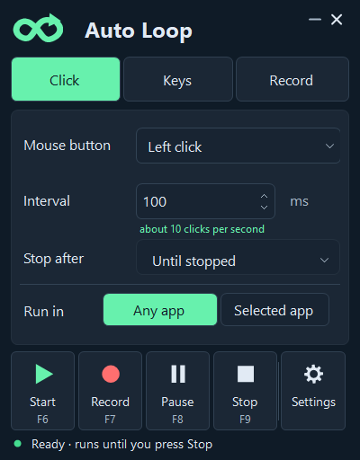
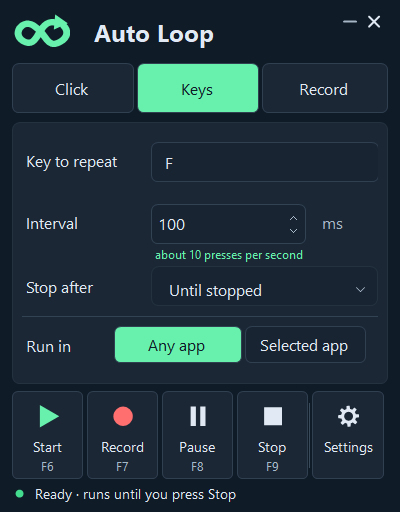
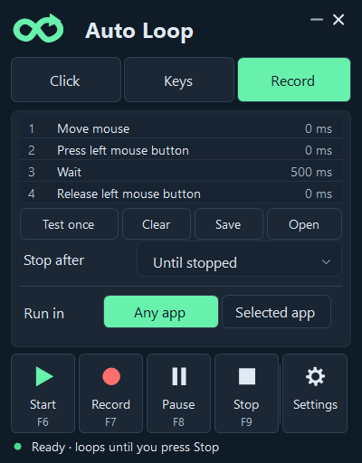
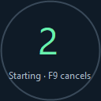
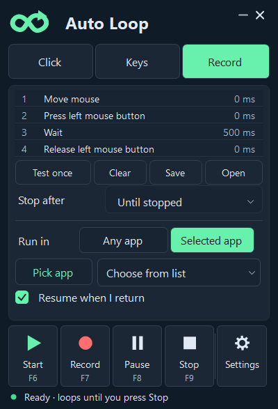

# Auto Loop

**A small, portable Windows auto-clicker, key repeater and macro recorder. No scripts, no installer.**

Repeat a mouse click, hold down a rhythm on one key, or record a sequence of clicks, keys and scrolls and play it back on a loop. Auto Loop is about 250 KB, runs from any folder you can write to, and never connects to the internet.

[](https://github.com/RikkYS/Auto-Loop/releases/latest)


[](LICENSE)

| Click | Keys | Record |
| --- | --- | --- |
|  |  |  |

While it runs, a small bar at the top of the screen shows progress with **Pause** and **Stop**, an icon sits by the clock, and Windows tells you when it's finished.

| Status bar while running | Countdown before it starts |
| --- | --- |
|  |  |

## Features

- **Click**: repeat left, right or middle clicks at the pointer or at a fixed screen position.
- **Plain-language hints**: "about 10 clicks per second" under the interval, and "about 600 clicks, then stops" in the status line, so you never have to work out milliseconds.
- **Keys**: repeat any single key at a set interval.
- **Record & replay**: capture mouse moves, clicks, drags, scrolling and keys, then loop them. Edit the delay before any step or remove steps.
- **Stop rules**: stop after a number of repeats, after a number of seconds, or only when you press Stop.
- **Any app or Selected app**: let input follow whichever window is active, or tie it to one app so it pauses the moment you switch away. Press **Pick app** and click the window you want, or choose it from the list.
- **Always know what's happening**: a big 3-2-1 countdown, a floating status bar with Pause and Stop, a tray icon, and a "finished" notice.
- **Remembers your settings** between launches, including the selected app when it's still open.
- **Global shortcuts** (changeable): F6 Start · F7 Record · F8 Pause · F9 Stop.
- **Safety first**: Auto Loop refuses to start playback without a working Stop shortcut, releases every held key and button on stop or pause, and never sends input into its own windows.
- **Portable**: settings and saved routines live next to the EXE. No accounts, telemetry or network access.

## Download

1. Get **Auto-Loop-…-Portable.zip** from the [latest release](https://github.com/RikkYS/Auto-Loop/releases/latest).
2. Extract it to a folder you can write to (not Program Files, and don't run it from inside the ZIP).
3. Open **Auto Loop.exe**.

Needs 64-bit Windows 10 or 11 with .NET Framework 4.x, which is already installed on Windows 10 and 11.

> **"Windows protected your PC"?** The EXE isn't code-signed yet, so SmartScreen may warn you the first time. Choose **More info → Run anyway**. You can check the download against `SHA256SUMS.txt` from the release:
>
> ```powershell
> Get-FileHash ".\Auto-Loop-0.7.0-Portable.zip" -Algorithm SHA256
> ```

## Quick start: five clicks in Notepad

1. Open a blank Notepad window.
2. In Auto Loop choose **Click**, set **Interval** to `500` ms and **Stop after** to `5 repeats`.
3. Choose **Selected app**, press **Pick app**, and click the Notepad window.
4. Press **Start**. Auto Loop minimizes and a 3-2-1 countdown appears; switch to Notepad and rest the pointer over the page.
5. Five clicks later it stops on its own and tells you it's finished. Press **F9**, or **Stop** on the status bar, to stop early.

## Record and replay

1. Press **F7** and switch to the app you want to automate during the countdown.
2. Do the actions you want repeated.
3. Press **F7** again, or **Finish** on the status bar, to finish. (Clicks on Auto Loop's own windows are never recorded. If the status bar is in your way, drag it aside.)
4. Press **Test once** to play a single pass, then **Start** to loop it with your Stop after rule.
5. Press **Save** to keep the routine as a `.autoloop` file and **Open** to load it later.

Right-click a step to change the delay before it or remove it. Recordings replay **screen positions**: keep the target window in the same place and the same display layout and scaling. See the [illustrated guide](GUIDE.md) for more.

## Any app or Selected app

| | Any app | Selected app |
| --- | --- | --- |
| Input goes to | whichever window is active | only the app you picked, including its dialogs and menus |
| Pauses when | Auto Loop itself is in front | you switch to another window |
| A click would land outside the app | n/a | playback **pauses** instead of clicking; press Pause (F8) to continue |



When playback pauses, the repeat it was in starts again from its first step on resume. Keep that in mind for actions that shouldn't happen twice, such as clicking *Send*.

## Limits

- **Apps running as administrator** ignore input from normal apps (a Windows rule). Auto Loop warns you instead of silently doing nothing. Run Auto Loop as administrator if you need to automate one.
- **Games**: many games read input in ways that ignore simulated keys, and some forbid automation. Check the game's rules first.
- **No image recognition.** Auto Loop doesn't look at the screen or wait for windows to load; add longer delays where an app needs time.
- Routines contain the keys you pressed. Check a routine before sharing it if you typed anything private.

## Build from source

On Windows with the .NET Framework 4.x C# compiler (built into Windows), run:

```powershell
./build.ps1
```

This creates `Auto Loop.exe` in the project folder. The app has built-in checks:

```powershell
& ".\Auto Loop.exe" --self-test C:\path\to\empty-folder
```

`--preview <folder> <scale>` renders the UI at a display scale such as `1.5` (150%) to check layouts. See [TESTING.txt](TESTING.txt) for what is and isn't covered.

## Report a problem

[Open an issue](https://github.com/RikkYS/Auto-Loop/issues/new/choose) with your Windows version and display scaling, the Auto Loop version, the mode (Click, Keys or Record), Any app or Selected app, the steps to reproduce, and what you expected to happen. If Auto Loop showed a message, include its exact text. Remove anything private from a routine before attaching it.

See [CHANGELOG.md](CHANGELOG.md) for what changed in each version.

## License

Auto Loop is released under the [MIT License](LICENSE). You're free to use, change and share it, provided the copyright notice stays with it. It comes with no warranty.
