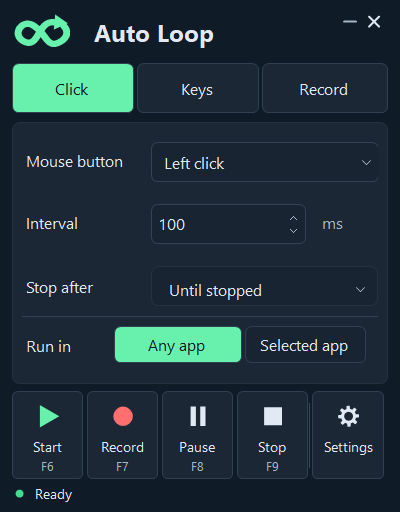

# Auto Loop

**A portable Windows auto-clicker, key repeater, and macro recorder. No scripting required.**

Repeat a click, press a key, or record a task and play it back—all from one compact app.

[Download ZIP](https://github.com/RikkYS/Auto-Loop/releases/download/v0.6.0/Auto-Loop-0.6.0-Portable.zip) · [Download EXE](https://github.com/RikkYS/Auto-Loop/releases/download/v0.6.0/Auto-Loop-0.6.0.exe) · [Full guide](GUIDE.md)

**Windows x64 · No installer · Early preview**

## What you can do

- **Click:** repeat left, right, or middle mouse clicks.
- **Keys:** choose a key by pressing it, then repeat it at your interval.
- **Record:** capture mouse and keyboard actions, save them, and replay them.
- Run in **Any app**, or choose a **Selected app** that pauses when you switch away.
- Stop after a repeat count, a time limit, or when you press Stop.

## Get started

1. Download the ZIP, extract it, and open **Auto Loop.exe**.
2. Choose **Click**, **Keys**, or **Record** and adjust the settings.
3. Press **F6** to start. Playback minimizes Auto Loop and begins after three seconds.
4. Press **F9** to stop. For recordings, use **Test once** before looping.

**Default shortcuts:** F6 Start · F7 Record/finish · F8 Pause/resume · F9 Stop.

Requires 64-bit Windows and .NET Framework 4.x. Keep the app in a writable folder so it can save settings and recordings.

## Good to know

Recordings use screen positions, so keep your window layout consistent. This is an early preview: 46 automated checks passed, but live app compatibility is not fully verified. The EXE is unsigned; game compatibility is untested.

[Illustrated guide](GUIDE.md) · [Testing and known limits](TESTING.txt) · [Report a problem](https://github.com/RikkYS/Auto-Loop/issues)
